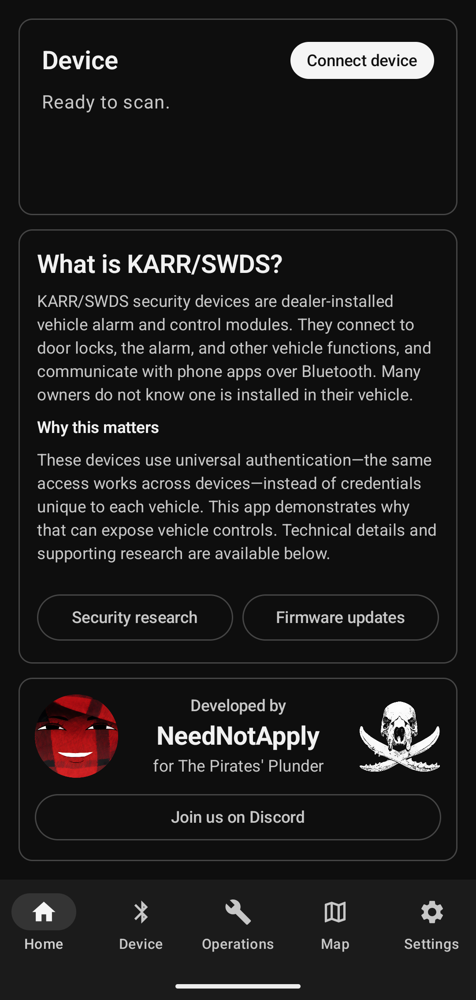
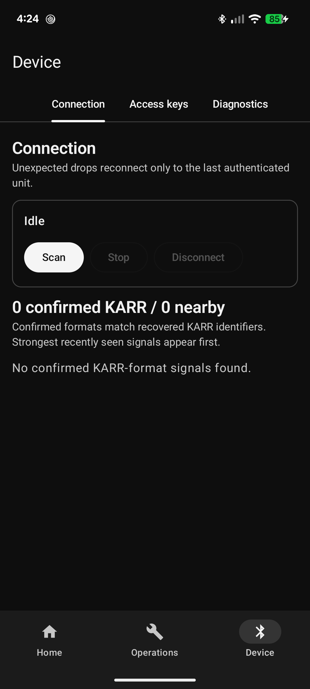
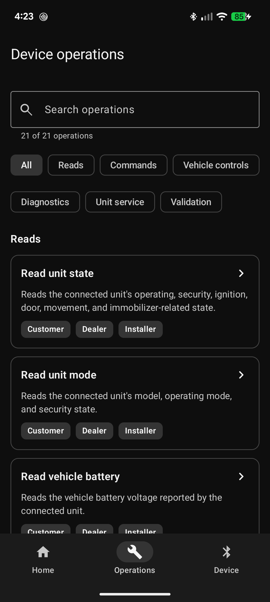
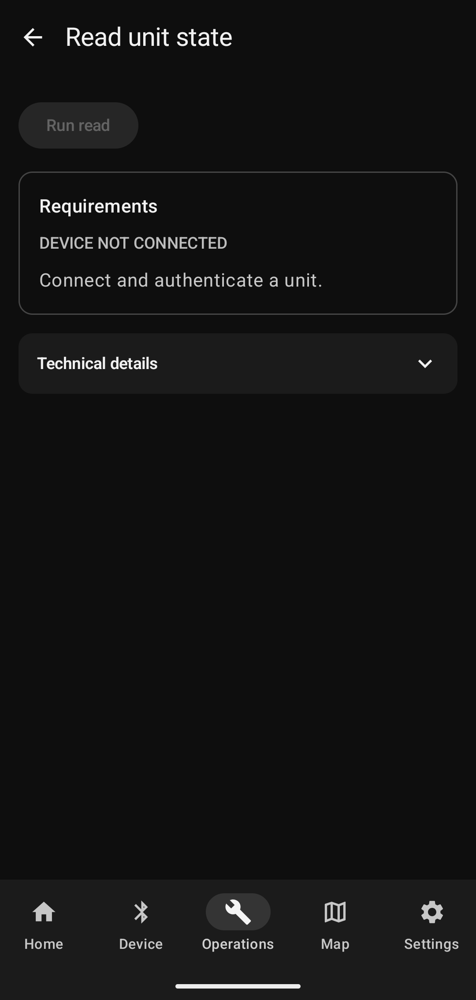
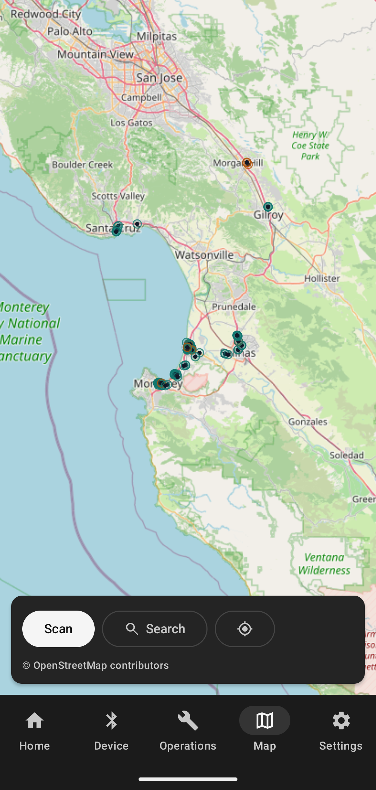
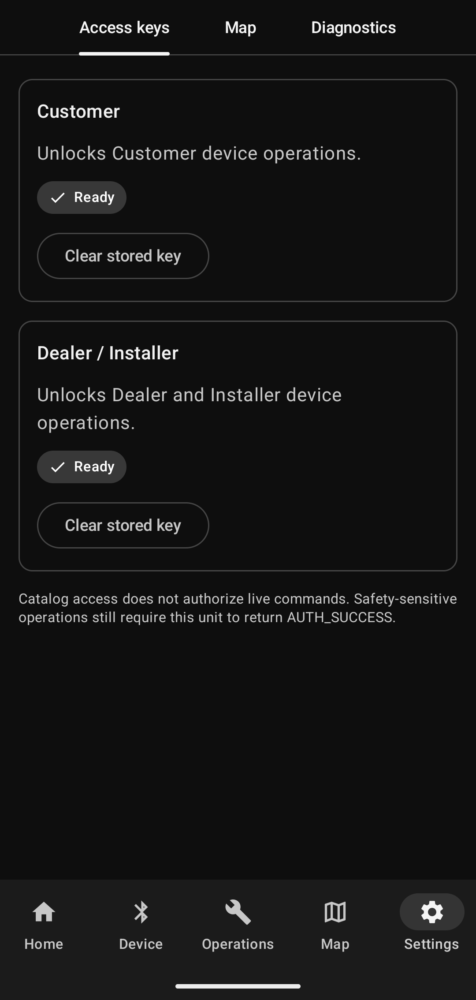

# KARR Key

KARR Key is an Android research app that demonstrates a security problem in
some older, dealer-installed KARR vehicle security systems.

These devices are connected to the CAN bus, the internal network used by many
systems in a vehicle. They need that access to lock doors, sound alarms, read
vehicle information, and perform other security functions. Some older models
also identify themselves over Bluetooth and use security information that was
built into the original mobile apps. If that older connection and login process
is reproduced, it can expose much of the vehicle control available to the KARR
unit.

KARR Key makes that problem visible with a local, Bluetooth-based proof of
concept. It is intended only for authorized research and testing. The app does
not include recovered passwords or universal device keys.

## Screenshots

These real-device screenshots were captured from KARR Key 1.0.3 on a Pixel 6a.
Select an image to view it at full resolution.

<table>
  <tr>
    <td align="center">
      <a href="docs/screenshots/home.png">
        
      </a>
      <br><sub>Home and research overview</sub>
    </td>
    <td align="center">
      <a href="docs/screenshots/device.png">
        
      </a>
      <br><sub>Bluetooth connection and scan controls</sub>
    </td>
  </tr>
  <tr>
    <td align="center">
      <a href="docs/screenshots/operations.png">
        
      </a>
      <br><sub>Searchable operations catalog</sub>
    </td>
    <td align="center">
      <a href="docs/screenshots/operation-detail.png">
        
      </a>
      <br><sub>Authentication-gated operation detail</sub>
    </td>
  </tr>
  <tr>
    <td align="center">
      <a href="docs/screenshots/map.png">
        
      </a>
      <br><sub>Discovered-device map with search and recenter</sub>
    </td>
    <td align="center">
      <a href="docs/screenshots/settings.png">
        
      </a>
      <br><sub>Access keys, map data, and diagnostics settings</sub>
    </td>
  </tr>
</table>

## Learn more

- [Read about the security research](https://today.ucsd.edu/story/2-million-cars-with-anti-theft-systems-installed-by-dealers-are-at-higher-risk-of-theft)
- [View the official firmware update instructions](https://www.karrsecurity.com/karr-security-firmware-update-instructions)

## What the app can do

- Find nearby KARR units by their recognizable Bluetooth names and wireless
  service.
- Connect to an authorized unit using research access information supplied by
  the user.
- Read information from the unit and send recovered vehicle or service
  commands.
- Show 25 unique operations without repeating the same command for different
  Customer, Dealer, or Installer workflows.
- Search the operations list or filter it with **Reads**, **Commands**, **Unit
  mode**, or **Experimental**. Deselect the active tag to show all operations;
  redundant workflow tags are omitted.
- Identify the connected model and operating mode, then label restrictions as
  either **Hardware** or **Unit mode**. Hardware-incompatible operations remain
  disabled; mode-restricted operations can be opened to see and start an
  authorized recovered mode-switch path.
- Show the difference between a command reaching Bluetooth, the KARR unit
  replying, and the vehicle physically doing something.

Vehicle operations, Bluetooth authentication, access keys, and history work
locally with no account system, cloud service, or backend. The Map page uses
Android foreground location and requests OpenStreetMap tiles on demand, caching
only tiles the user views.

## App layout

### Home

Home briefly explains the security issue, shows the current connection status,
and links to the research and firmware update instructions.

### Device

Device is where the user adds their research access information, scans for a
unit, connects, authenticates, and views Bluetooth diagnostics. Saved access
information is protected by Android Keystore and is never built into the app.

The Android scan is not restricted by a name or service filter. Every delivered
BLE advertisement is classified using the recovered DR/QT formats, Dealer
manufacturer frames (including embedded 13-character serials and QT6, QT7,
DR1, DR2, CIU, and VW-programmer status types), branded names, and the shared
transparent-UART service. Status-only manufacturer frames must match both the
recovered model-bit layout and numeric five-character VIN-tail encoding; model
bits alone are not unique enough. Possible matches are shown separately instead
of being discarded, but only connectable confirmed-format results can be opened.
Here, confirmed means the identifier and parser are present in recovered KARR
source material; it does not by itself mean that model was physically tested.
The app does not treat a MAC/OUI prefix as KARR proof: BLE addresses may be
random, and a public prefix identifies the radio/interface vendor rather than
the product or its owner.

End-to-end operation has been confirmed on real hardware advertising as a `DR`
unit. Recognition of the other recovered families and formats is source- and
test-backed, but is not yet physical-hardware confirmation for those models.

The app requests Android's maximum-duty BLE scan mode until the user stops it.
This increases the chance of receiving a weak advertisement but does not raise
the KARR unit's transmit power or the phone's receiver sensitivity. The Device
screen stays awake during the scan because Android can pause an unfiltered scan
after the screen turns off; the foreground notification provides a Stop action.
If a connection unexpectedly drops, the app only tries to reconnect to the last
unit that successfully authenticated.

### Operations

Operations contains the searchable, filterable list of reads and commands.
Operations that are incompatible with the connected KARR hardware are visibly
disabled with a model-specific reason. An operation blocked only by the current
unit mode remains selectable and explains the required mode. When the recovered
transition graph and current access permit it, the detail page links to the
appropriate mode switch or first step of a multi-step path.

One Installer immobilizer-output command is marked **Experimental**. It is sent
only once, requires the ignition to be off, and does not treat a reply from the
unit as proof that the vehicle was physically immobilized. Its detail page pairs
the candidate with the separate recovered **Unlock and disarm** operation,
presented there under the **Restore drivable state** safety heading. The candidate
stays unavailable unless that recovery operation is authorized and compatible,
and the user is instructed to verify a drivable state before testing.

The recovered Installer section also exposes switches to Installer, Dealer,
User, No sale, and Borrowed Car Agreement (BCA) modes. All five transitions have
been confirmed by `READ_MODE` on authorized hardware and are no longer
experimental. They are offered only from the source modes used by preserved
callers. Each `CHANGE_MODE` packet is sent once, then the app issues `READ_MODE`;
success is shown only when the unit reports the requested mode. Bootload and
Unconfigured are not exposed as ordinary mode switches because the preserved
apps do not use them that way. The Device Operations list keeps its compact
transition summaries. After a mode operation is selected, its command page shows
a **Mode effect** section explaining which security or service behavior the target
mode enables, disables, or temporarily changes.

### Map

Map plots KARR candidate advertisements from active scans using the phone's
foreground location fix and each advertisement's RSSI. Stronger RSSI produces a
smaller confidence circle; weaker RSSI and poorer location accuracy produce a
larger circle. Map uses osmdroid with OpenStreetMap raster tiles and visible OSM
attribution, and supports the full OSM zoom range. It does not use Google Maps
or Google Play Services.

A **Search** button finds a previously discovered device by name, showing when
it was last seen and jumping the map to it when selected. A **Recenter** button
returns the map to the phone's current location without changing the zoom
level. Map history is stored locally until the user clears it; device
identifiers and coordinates are encrypted with Android Keystore-backed storage.

### Settings

Settings has three tabs. **Access keys** manages the Customer and
Dealer/Installer research access information used to authenticate with a unit,
each independently clearable. **Map** shows how many map observations are
stored, clears that history, and imports or exports it as a WiGLE-compatible
CSV; importing a foreign WiGLE file only keeps devices that match KARR's
discovery logic. **Diagnostics** runs a self-test and previews the most recent
decoded Bluetooth notification.

## Important limits

- Finding a device over Bluetooth does not prove ownership or permission to
  use it.
- A Bluetooth connection is not enough to run commands. The KARR unit must
  complete its own authentication for the current connection.
- KARR Key supports the older authentication method recovered from the legacy
  apps. It does not support the newer per-unit method.
- KARR Key is not a firmware installer or a general-purpose CAN bus tool. It
  only exposes operations supported by the preserved app evidence.
- A response from the KARR unit does not prove that a door, alarm, trunk, or
  other physical part of the vehicle changed state.
- The app has been installed and smoke-tested on a Pixel 6a. That confirms the
  Android app and interface work; testing real vehicle behavior still requires
  an authorized compatible unit and direct observation.

## Design and navigation

The interface uses a greyscale light and dark theme. Home, Device, Operations,
Map, and Settings are selected from the navigation bar, in that order.
Operation details use the normal Android back action.

## Building the app

Developers need JDK 17, Android SDK 36, and either `local.properties` or
`ANDROID_HOME` configured for that SDK.

```powershell
.\gradlew.bat --no-daemon testDebugUnitTest lintDebug assembleDebug :app:assembleDebugAndroidTest
```

On Linux or macOS, use `./gradlew`. The debug APK is written to
`app/build/outputs/apk/debug/KARR-Key.apk` and uses package name `com.karr.key`.
The current app version is `1.0.3` (code 12).

The build checks that Map's Internet and network-state permissions are explicit,
Bluetooth scan keeps `neverForLocation`, and foreground location permissions
are explicit. GitHub Actions also runs the tests, lint, and debug build. A
nightly prerelease is created only when the main branch has changed since the
previous release.

Stable releases are also produced entirely by GitHub Actions. Pushing a tag in
the form `vMAJOR.MINOR.PATCH` runs the tests and lint against that exact tagged
commit, builds and verifies a CI-signed release APK, and creates the GitHub
release with that APK as its only uploaded asset. GitHub displays the APK's
SHA-256 digest directly on the release page, while the release notes retain the
source commit, workflow run, version, and signing-certificate fingerprint. The
workflow rejects a tag whose version does not match the app's `versionName`;
release APKs are never uploaded manually.

For implementation details and exact safety rules, see
[DEVELOPMENT.md](DEVELOPMENT.md). For the preserved research evidence, see
[research/README.md](research/README.md).

## Identity and licensing

KARR Key is not an official KARR, Webhouse Group, Southwest Dealer Services, or
vehicle-manufacturer project. Product names are used only to identify the
subject of this research.

No open-source license has been selected. Until one is added, this repository
does not grant redistribution or modification rights. The original APKs retain
their owners' rights.
